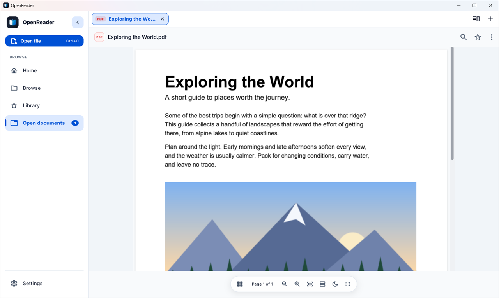
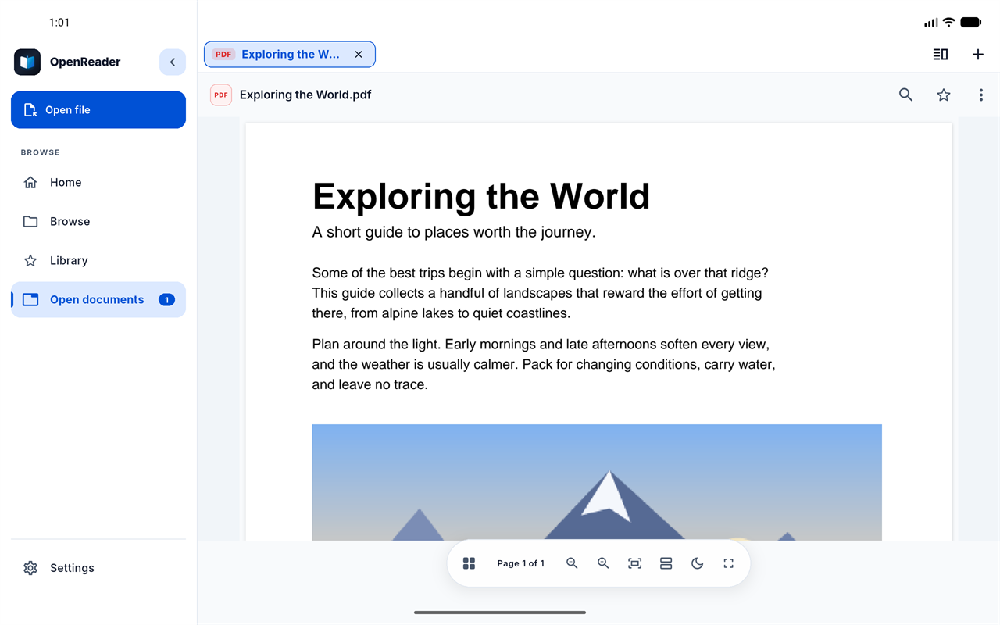
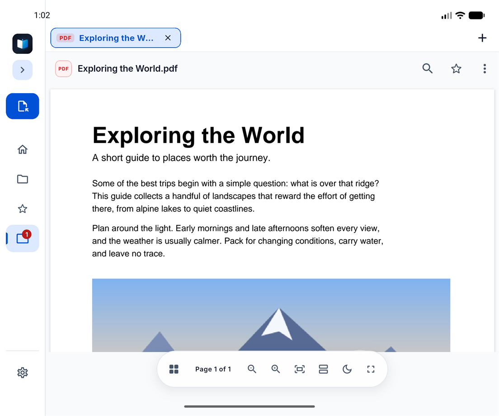
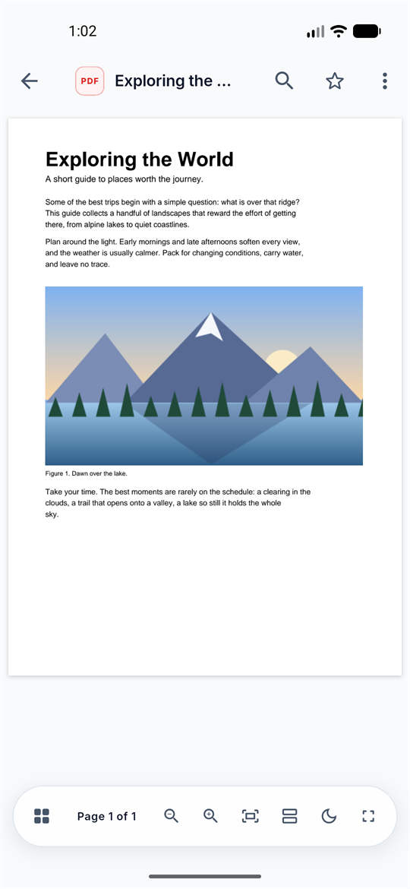

<p align="center">
  
</p>

<h1 align="center">OpenReader</h1>

<p align="center"><b>All your documents. One beautiful reader.</b><br />
Free · Open source · Cross-platform · Works offline · No registration</p>

<p align="center">
  <a href="https://macdipu.github.io/OpenReader/">Website</a> ·
  <a href="https://github.com/macdipu/OpenReader/releases/latest">Download</a> ·
  <a href="#installation">Installation</a> ·
  <a href="#troubleshooting">Troubleshooting</a> ·
  <a href="docs/ui-audit/README.md">UI audit</a>
</p>

<p align="center">
  
  
</p>
<p align="center">
  
  
</p>

OpenReader is a document reader built with Flutter. It lets you browse, open, read, search and navigate the documents on your device, with no account and no server: nothing you open ever leaves it.

## Features

- **Seven formats, one app:** PDF (page-based), Word (paginated/flow), Excel and CSV (spreadsheet grid), PowerPoint slides, Markdown and plain text.
- **Offline and private:** zero network calls, no accounts, no analytics. A local SQLite index remembers Recents and Favorites.
- **Adaptive layout:** bottom bar on phones, side rail and tabs on tablets and desktops, fold-aware on foldables.
- **Night mode** in every reader, plus light and dark app themes.
- **Open from anywhere:** in-app folder browser, Open file (`Ctrl+O` / `⌘O`), drag and drop on desktop, the command line (`openreader file.pdf`), Open With, and files shared from other Android apps.
- **Several documents at once:** tabs and side-by-side panes.
- **Native integration:** per-type icons, Open With and a "make default reader" prompt.

Supported formats: **PDF, DOCX, XLSX, PPTX, CSV, Markdown (.md), TXT.** Legacy binary `.doc`, `.xls` and `.ppt` are not supported.

## Supported platforms

| Platform | Devices | Release asset |
|---|---|---|
| **Android** | phones, tablets, foldables | `.apk` (arm64-v8a, armeabi-v7a) · [Google Play](https://play.google.com/store/apps/details?id=com.chowdhuryelab.openreader) |
| **Windows** 10+ | 64-bit desktops and laptops | `.zip` (workflow only; not in v1.0.10) |
| **macOS** 12+ | Mac laptops and desktops | `.dmg` |
| **Linux** | x86_64 with GTK 3 | `.deb`, `.rpm`, `.AppImage`, `.tar.gz` |

There is **no iOS / iPadOS build**. The macOS and Linux packages are produced by the release workflow; [`docs/ui-audit/`](docs/ui-audit/README.md) lists which form factors have been exercised on real builds.

## Installation

Every download is on the [**GitHub Releases** page](https://github.com/macdipu/OpenReader/releases). The newest release is always at <https://github.com/macdipu/OpenReader/releases/latest>. Asset names are fixed by [`.github/workflows/release.yml`](.github/workflows/release.yml); `<tag>` is the release tag (for example `v1.0.11`), `<version>` and `<build>` are the app version and build number.

> **What is published today.** The newest release, **v1.0.10**, contains the Android APKs and AAB, `openreader-linux-x64-v1.0.10.tar.gz` and `openreader-macos-v1.0.10.zip`. It has **no Windows zip**, and the macOS `.dmg` and the Linux `.deb`, `.rpm` and AppImage described below are built by the release workflow but first appear with the **next tagged release**. Until then use the `.zip` / `.tar.gz` on those platforms.
>
> **One-line install:**
>
> ```bash
> # macOS and Linux (macOS: installs to /Applications; Linux: picks .deb / .rpm / AppImage / tarball)
> curl -fsSL https://raw.githubusercontent.com/macdipu/OpenReader/main/install.sh | sh
> ```
>
> ```powershell
> # Windows (PowerShell)
> irm https://raw.githubusercontent.com/macdipu/OpenReader/main/install.ps1 | iex
> ```
>
> Desktop builds are **not code-signed**, which is why Windows and macOS ask you to confirm the first launch.

### Windows

Asset: `OpenReader-<version>-windows-x64-setup.exe` (**not yet attached to any release**, see above), plus a portable `openreader-windows-x64-<tag>.zip`.

1. Download the `setup.exe` from Releases and run it. It installs per user (no admin rights) and, by default, adds OpenReader to **Open with**.
2. If SmartScreen appears, choose **More info → Run anyway**.

Or in PowerShell: `irm https://raw.githubusercontent.com/macdipu/OpenReader/main/install.ps1 | iex`

Prefer no installer? Extract the zip anywhere, run `openreader.exe`, and optionally run `powershell -ExecutionPolicy Bypass -File register-file-types.ps1`.

Needs 64-bit Windows 10 or later.

### macOS

Asset: `OpenReader-<version>-macos.dmg` (v1.0.10: `openreader-macos-v1.0.10.zip`; unzip it, then drag **OpenReader.app** onto **Applications**).

1. Open the `.dmg` and drag **OpenReader** onto **Applications**.
2. First launch: right-click the app and choose **Open**, then **Open** again (unsigned build).

Needs macOS 12 or later. The release workflow builds on GitHub's `macos-latest` runner (Apple silicon); an Intel-only Mac is untested.

### Linux

Assets (x86_64 only): `openreader_<version>-<build>_amd64.deb`, `openreader-<version>-<build>.x86_64.rpm`, `OpenReader-<version>-x86_64.AppImage`, `openreader-linux-x64-<tag>.tar.gz`.

```bash
# Any distribution, one line (picks .deb / .rpm / AppImage / tarball)
curl -fsSL https://raw.githubusercontent.com/macdipu/OpenReader/main/install.sh | sh

# Debian, Ubuntu, Linux Mint
sudo apt install ./openreader_<version>-<build>_amd64.deb

# Fedora, RHEL
sudo dnf install ./openreader-<version>-<build>.x86_64.rpm
# openSUSE
sudo zypper install ./openreader-<version>-<build>.x86_64.rpm

# Any distribution with GTK 3: no install
chmod +x OpenReader-<version>-x86_64.AppImage && ./OpenReader-<version>-x86_64.AppImage

# Tarball: extract, then add the launcher and Open With entry
mkdir -p ~/openreader && tar -xzf openreader-linux-x64-<tag>.tar.gz -C ~/openreader && ~/openreader/install-desktop-entry.sh
```

The packages pull in `libgtk-3` and `libsecret`; for the AppImage and tarball install them yourself if the app does not start.

### Android

- **Google Play:** <https://play.google.com/store/apps/details?id=com.chowdhuryelab.openreader>
- **APK:** download `openreader-arm64-v8a-<tag>.apk` (almost every current phone) or `openreader-armeabi-v7a-<tag>.apk` (older 32-bit devices) from Releases, open it, and allow "Install unknown apps" for your browser or file manager when Android asks.

The `.aab` file is the Google Play bundle, not something you install by hand.

Not sure of your CPU? Use `arm64-v8a`; Android refuses an APK that does not fit.

### Updating

- **Google Play:** updates arrive through the store.
- **Everything else:** download the newest asset from [Releases](https://github.com/macdipu/OpenReader/releases/latest) and install over the old one. Windows: extract over (or beside) the old folder. macOS: replace the app in Applications. Linux: install the new `.deb`/`.rpm`, or replace the AppImage. Android: install the new APK.
- Recents and favourites live in the app's own data folder, outside the install folder.

### Uninstalling

| Platform | Steps |
|---|---|
| Windows | Settings → Apps → OpenReader → Uninstall (zip install: run `register-file-types.ps1 -Unregister`, then delete the folder) |
| macOS | Drag **OpenReader** from Applications to the Bin |
| Linux | `sudo apt remove openreader` / `sudo dnf remove openreader`; AppImage: delete the file; tarball: `install-desktop-entry.sh --remove`, then delete the folder |
| Android | Settings → Apps → OpenReader → Uninstall |

## Troubleshooting

| Problem | Fix |
|---|---|
| Windows: "Windows protected your PC" | The build is unsigned. **More info → Run anyway.** |
| macOS: "cannot be opened because the developer cannot be verified" | Right-click the app → **Open** → **Open** |
| Linux: AppImage will not run | `chmod +x` it; install `libgtk-3-0` and `libsecret-1-0` |
| Linux: `.deb` fails on a missing dependency | `sudo apt -f install` |
| Android: "App not installed" | Wrong CPU type: try the other APK, or uninstall the Google Play version first (it is signed differently) |
| Android: cannot see my files | Grant "All files access" when onboarding asks, or use the in-app **Open file** picker |
| A `.doc`, `.xls` or `.ppt` will not open | Legacy binary Office formats are not supported; save as `.docx`, `.xlsx`, `.pptx` |
| Anything else | [Open an issue](https://github.com/macdipu/OpenReader/issues) with your OS, version and file type |

## Platforms and release builds

The layout adapts to window size (`lib/core/presentation/utils/screen_utils.dart`): phones get a bottom navigation bar, tablets and desktop windows get a side rail, an "Open file" button, and width-capped content.

## Building from source

```bash
flutter pub get
flutter run                                    # debug, on the connected device or desktop
flutter build apk --release --split-per-abi    # Android
flutter build windows --release                # run on Windows
flutter build macos --release                  # run on macOS
flutter build linux --release                  # run on Linux (needs libgtk-3-dev, libsecret-1-dev, ninja-build)
```

Each desktop target must be built on its own OS. `.github/workflows/release.yml` builds all four on a version tag and attaches the artifacts to the GitHub release. Installer scripts: `macos/dmg/make-dmg.sh` (background from `tool/generate_dmg_background.ps1`) and `linux/packaging/package-linux.sh` (checked by `tool/test_linux_packages.sh` in Debian and Fedora containers).

The landing page (`docs/`, served by GitHub Pages) is plain HTML, CSS and JS. Its device screenshots come from `tool/capture_window.ps1` and `tool/make_device_assets.ps1`.

**Keeping this README in step with releases:** the asset names above come from the *Package* steps of `release.yml`. When that workflow, the app version or a download link changes, update the Installation section and `docs/index.html` together.

## Licence

The repository ([macdipu/OpenReader](https://github.com/macdipu/OpenReader); GitHub reports no licence) does not contain a `LICENSE` file yet, so no licence grant is stated here. The document engine it uses, [`universal_document_viewer`](https://github.com/macdipu/universal_document_viewer), is MIT-licensed. *(Maintainer: add a `LICENSE` file; the website and this README call the project open source.)*

---

## Tech Stack

- **Framework:** Flutter (SDK `>=3.2.3 <4.0.0`)
- **State management:** GetX
- **Architecture:** Clean Architecture (presentation / domain / data per feature)
- **Local storage:** sqflite (document index), shared_preferences, flutter_secure_storage
- **Document rendering:** universal_document_viewer, its own repository ([github.com/macdipu/universal_document_viewer](https://github.com/macdipu/universal_document_viewer)): its own PDF, Word, Excel/CSV, PowerPoint and text engines (CR-OWN-ENGINES)
- **File integration:** open_filex (Open With), receive_sharing_intent (Open From Other Apps)
- **Push notifications:** firebase_core / firebase_messaging (currently disabled — see `TODO` in `lib/app/flavours/app_flavour.dart`)

---

## Getting Started

OpenReader is fully offline and calls no API, so there's no environment/config setup step.

1. **Clone the repository**
2. **Install dependencies:** `flutter pub get`
3. **Run the app:** `flutter run`
4. **Run tests:** `flutter test`

---

## Project Structure

```
lib/
├── app/                  ← App bootstrap, flavours, top-level view
├── core/                 ← Shared data/domain/presentation (cache, widgets, controllers)
├── features/             ← One folder per feature (pdf_reader, word_reader, excel_reader, csv_reader,
│                            text_reader, files, home, recents, favorites, search, settings,
│                            onboarding, splash, file_information)
├── services/             ← Platform integration (Open With, Open From Other Apps, push notifications)
├── res/                  ← Routes, strings, themes
└── main.dart
```

Each feature follows Clean Architecture layering:

```
features/<feature_name>/
├── data/         ← repo_impl, models
├── domain/       ← entity, repo interface, usecase
└── presentation/ ← controller, screens, bindings
```

---

## Feature Generator

New feature scaffolding (folders, entity, repo, controller, bindings, routes wiring) can be generated with:

```bash
dart generate_feature.dart <feature_name>
```

This generates the Clean Architecture + GetX skeleton for a new feature; you then wire up the entity fields, API/response mapping, HTTP endpoint, and routes for the new feature. Use `lib/features/pdf_reader/` or `lib/features/text_reader/` as a reference for a complete, wired-up feature.

---

## Testing & Quality

- `flutter analyze` — 0 errors/warnings (informational lints only)
- `flutter test` — unit/widget coverage across services, repositories, controllers, and widgets (see `test/`)
- No CI configuration yet (`.github` absent) — checks are run locally/manually

Known gaps: the PowerPoint reader shows slide content (text, tables, pictures), not the original slide layout; no Android SDK/emulator available in this dev environment, so native rendering, real intent delivery (Open From Other Apps), and physical-device UAT remain to be verified on-device.

---

## Documentation

Project context, requirements, architecture, and task tracking live under `agentic/`:

- `agentic/data/project-context/features/OpenReader_BRD_v1.0.md` — business requirements
- `agentic/data/project-context/features/FEATURE-OPENREADER-P1..P5/` — per-phase SRS, architecture, and tasks
- `agentic/README.md` and `AGENTS.md` — agentic workflow entrypoint for this repo

---

## Docker Development (Run everything in containers)

You can run and test the app entirely inside Docker. This is the recommended way to ensure everyone on the team has the same SDKs, toolchains and emulator behaviour.

Quick start (emulator-in-container)

1. Build images and start services (emulator + flutter):

   ./scripts/start.sh

2. (If needed) force adb connect:

   ./scripts/start.sh connect

Troubleshooting: "No physical devices found" and connection errors

- If you see a message like "No physical devices found. Attempting to connect to emulator at :5555" or "no host in ':5555'", it means the start script could not determine the emulator container IP. Try:

  - Run: ./scripts/start.sh connect
  - If that still shows no devices, exec into the flutter container and try connecting to the emulator service name (Docker internal DNS):

    docker compose exec -u developer -T flutter bash -lc "/opt/android-sdk/platform-tools/adb connect emulator:5555 && /opt/android-sdk/platform-tools/adb devices -l"

  - Or get the emulator container IP and connect directly (replace <ip>):

    EMU_IP=$(docker inspect -f '{{range.NetworkSettings.Networks}}{{.IPAddress}}{{end}}' $(docker compose ps -q emulator))
    docker compose exec -u developer -T flutter bash -lc "/opt/android-sdk/platform-tools/adb connect ${EMU_IP}:5555 && /opt/android-sdk/platform-tools/adb devices -l"

  - If you plan to access adb from your local machine, create an SSH tunnel from your laptop to the server to forward port 5555 (recommended) instead of opening ports in the server firewall.

3. Exec into flutter container and run the app:

   ./scripts/start.sh shell
   # inside container
   flutter pub get
   flutter devices
   flutter run -d <device-id>

Alternatively use the convenience script to connect adb from the flutter container to the emulator container:

    ./scripts/start.sh connect

Or to connect host adb to the emulator (requires adb on host):

    ./scripts/start.sh connect host

Run a single flutter command from the host (convenience via Makefile):

  make flutter run -d <device-id>

Makefile targets (shortcuts):

- make up         # build + start (same as ./scripts/start.sh up)
- make connect    # connect flutter adb to emulator
- make shell      # open shell into flutter container
- make flutter ...# run flutter <args> inside the container
- make down       # stop and remove containers
- make logs       # follow emulator logs

Additional Makefile helpers:

- make ensure-perms     # ensure repo helper scripts are executable
- make recreate-volumes # remove compose volumes and restart emulator (repopulates SDK bundle)
- make reset-volumes    # alias for recreate-volumes
- make devcontainer     # start VS Code devcontainer via devcontainer CLI (if .devcontainer exists)
- make emulator-container   # start the emulator via the repo scripts in container mode (EMULATOR_MODE=container)
- make emulator-host-connect # connect the flutter container to a host-running emulator (EMULATOR_MODE=host)

Emulator Modes

- container: runs the emulator fully inside Docker. Reliable on Linux with KVM (x86_64), and supported on Apple Silicon (ARM64). On macOS Intel/Windows, uses x86_64 emulation (slower but works).
- host: run the Android emulator on your host (Android Studio or sdk/emulator) and connect the Flutter container to it via adb (adb connect localhost:5555).
- auto (default): the start script detects the host OS/arch and chooses container mode where supported, else host mode.

You can override with EMULATOR_MODE=container|host|auto when running scripts/start.sh or `make up`.

### macOS Apple Silicon (M1/M2/M3) Setup

The setup automatically detects Apple Silicon (ARM64) and uses the ARM64 Android emulator in container mode.

1. Ensure ARM64 emulator binaries are available (copy `linux/emulator/` from cryze repo or build them) into `docker/emulator/` directory.

2. Run in container mode (detected automatically):

   ```bash
   make up
   ```

3. Connect and run Flutter:

   ```bash
   make connect
   make flutter devices
   make flutter run -d emulator-5554
   ```

**Multi-OS Support:** The setup automatically detects the host architecture:
- **ARM64 (Apple Silicon):** Uses ARM64 emulator in container mode
- **x86_64 (Intel Macs, Linux, Windows):** Uses x86_64 emulator in container mode (requires KVM on Linux for best performance) or falls back to host mode

For graphical interaction, use scrcpy with the VNC port (5900) or connect to the emulator via ADB.

### Use a physical Android device (Linux USB passthrough)

1. Start with the usb override (Linux only):

   docker compose -f docker-compose.yml -f docker-compose.override.usb.yml up --build -d

2. Then run the normal start and connect commands (start.sh will still help):

    ./scripts/start.sh
    ./scripts/start.sh connect

### Host emulator (macOS/Windows)

- Start the emulator on your host (Android Studio or command line) and then connect the flutter container to the host adb:

  docker compose exec flutter bash -lc "/opt/android-sdk/platform-tools/adb connect host.docker.internal:5555"

### Stopping everything

  docker compose down

### Alternative: use a prebuilt android-build-box image for one-off commands

If you prefer not to build the images in this repo you can use the community image `mingc/android-build-box` to run one-off commands against the project folder (example below runs tests):

  docker run --rm -v "$(pwd)":/project -w /project -e ANDROID_SDK_ROOT=/opt/android-sdk mingc/android-build-box:latest bash -lc "flutter pub get && flutter test"

### docker-compose (no custom Dockerfiles)

1. Start stack (emulator + flutter + scrcpy-web):

   make up

2. Open a shell inside the flutter container:

   make shell

3. Run flutter commands from host via Makefile:

   make flutter devices
   make flutter run -d emulator

4. Open scrcpy-web (VNC-like web UI) in your browser at:

   http://localhost:8080

Notes:

- The compose stack uses the public image mingc/android-build-box for both the emulator (android) and the flutter dev container (flutter). No custom image is built.
- scrcpy-web connects to the adb server exported by the android service. If scrcpy-web doesn't show the device, exec into the scrcpy-web container and ensure it can reach adb at android:5037.
- To stop everything: `make down`.

Port collisions and multi-arch images

- If port 8080 is already used on the host, the compose `up` will fail. You can change the host port for scrcpy-web with an environment variable when running compose, for example:

  SCRCPY_WEB_PORT=8081 make up

- The scrcpy-web image used must match your host architecture. The compose file uses a multi-arch-friendly image by default; if you still see platform mismatch messages, select a scrcpy-web image that matches your host (search Docker Hub for `scrcpy-web` and pick an image with the appropriate platform support).

### VS Code devcontainer

- Open the repository in VS Code and use the Remote - Containers (Dev Containers) extension to reopen in container. The .devcontainer/devcontainer.json targets the `flutter` service.

More commands and troubleshooting are available in `docker/README.md` — it contains detailed platform-specific instructions and examples.

---

## Additional Resources

- [Clean Architecture by Robert C. Martin](https://blog.cleancoder.com/uncle-bob/2012/08/13/the-clean-architecture.html)
- [GetX Documentation](https://pub.dev/packages/get)
- [Dartz for Functional Programming](https://pub.dev/packages/dartz)

---

## Contributing

1. Read [Building from source](#building-from-source), then check `agentic/data/project-context/` for current requirements/architecture before making changes
2. Follow the established Clean Architecture + GetX patterns (use `generate_feature.dart` for new features)
3. Run `flutter analyze` and `flutter test` before submitting
4. Submit your PR
